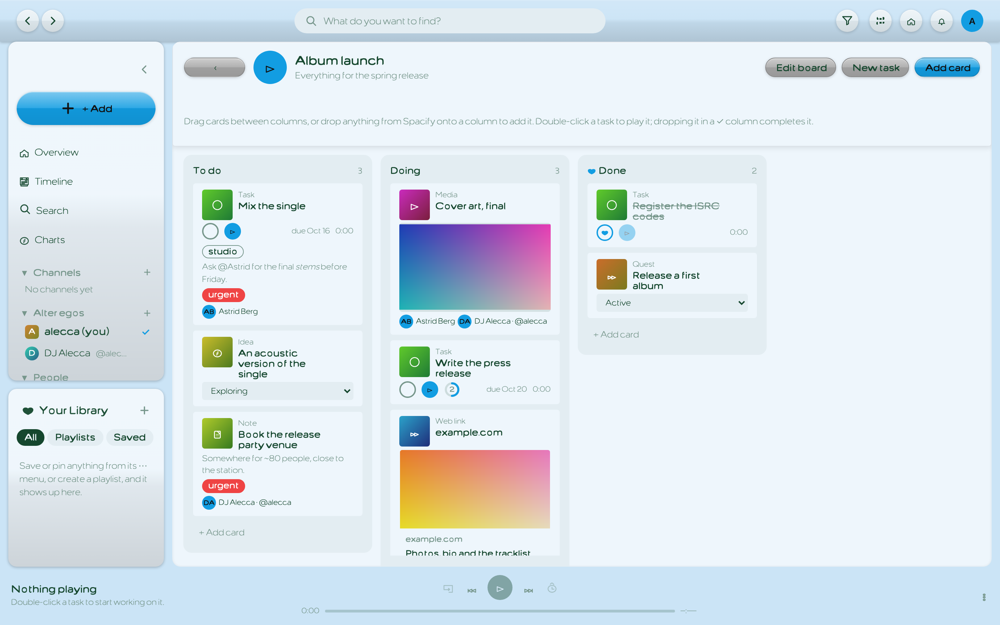
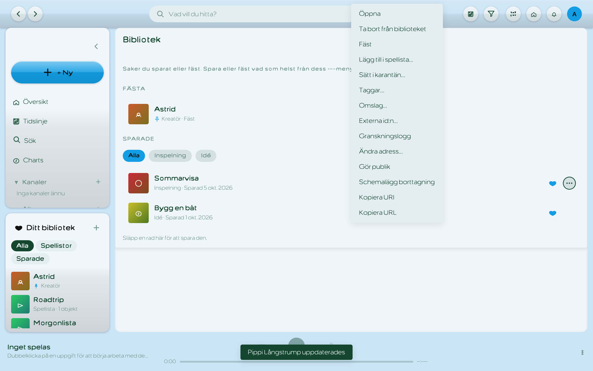
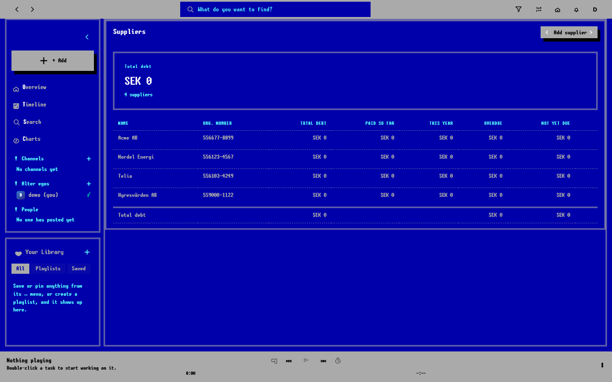
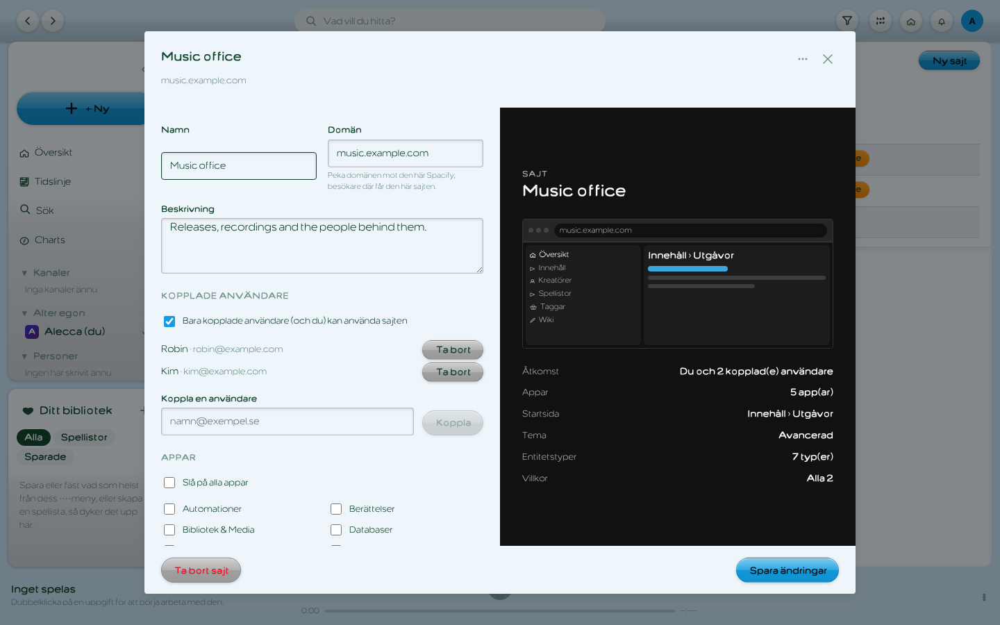

# Gondol

**A web application framework for building apps out of apps**, on TanStack Start, React and
Supabase. Gondol is the frame: an application shell that looks and feels like a music player, a
theming engine, navigation, search, an entity system and an apps framework. It originated from an internal tool built on it which organized its functionality as a *bundle of apps* (Finances, Wiki, Playlists, …), each self-contained, described by a
manifest and switchable on and off by every user and every site.

**Documentation:** [drsounds.github.io/gondol](https://drsounds.github.io/gondol/), built from
[`docs/`](docs/): getting started, building apps and features, entities, the shell, theming, a
tutorial and a module reference.



<sub>Screenshots are from Spacify with made-up demo data.</sub>

## Why

Most products grow into many small tools that should know about each other: a task can point at a
document, a playlist can hold anything, search should find everything. Gondol makes that the
default. Register an entity type once and it gets an address, a URI, search, a row menu, drag and
drop, library and playlist support, edit sheets and filtering for free; register an app once and it
gets a place in the navigation, the command palette, the create picker and every site's settings.

It stays flexible because gondol never imports from the app: everything reaches it through
`configureGondol()`, type augmentation and props, so the same shell can carry a very different
product, and one deployment can look like several products on different domains.

## Advantages

The goal for Gondol is to take the Eclipse paradigm to the web: Define a core 'OS' for common infrastructure, so developers (with agents) can focus on functionality, and experiment with different features, objectives under different name. The inspiration was taken from [Spotify Portal](https://technology.spotify.com) and [Spotify Confidence](https://technology.spotify.com] but we found it lacked a great ready to made feature based architecture as Spotify's commercial developer tools is focused on devOps infrastructure, not frameworking for applications

## Features

- ✅ **Application shell**: chrome bar with back, forward and search, sidebar built from the active apps, phone navigation drawer, slots for widgets such as a bottom player bar, keyboard shortcuts and a command palette
- ✅ **Apps framework**: apps described by `manifest.json`, features (pages), actions, widgets and providers, dependencies between apps, per-user activation
- ✅ **Entity system**: `scheme:type:key` URIs, readable public addresses (`/note/shopping-list`), base62 identifiers and custom slugs, labels and art from registered sources
- ✅ **Entity UI**: `EntitySheet` (routed create and edit sheets with a fixed-dark preview pane), `FormActions`, `ActionMenu` (row menu, context menu, long-press bottom sheet), `EntityPicker`, drag and drop
- ✅ **URL-first state**: sheets are routes (`useEntityModal`), search and the global filter live in the query string and survive navigation
- ✅ **Search and the global filter**: one Postgres full-text search behind the search page, `@` mentions and pickers; a filter and date period that apply to every view
- ✅ **Theming engine**: light and dark, any accent, palettes, the Aero and TUI (DOS and mainframe text mode) engines, neon glow, high contrast, synced to the user's account
- ✅ **Sites**: serve the app on many domains, each with its own apps, users, roles and aspects, theme, layout and visitor defaults or locks
- ✅ **Bungalow design system** and its icon font
- ✅ **English and Swedish** strings, merged with the app's own catalogue
- ✅ **Desktop shell bridge** for Tauri and Electron
- ✅ **Supabase base**: lazily created browser and server clients, auth middleware, session, base schema types
- ⏳ **Hooks and resolutions, lazy pages, subset builds**: in progress in [#14](https://github.com/drsounds/gondol/pull/14), see [Architecture](#architecture)

| | |
| --- | --- |
|  |  |



## Architecture

```
┌──────────────────────────────────────────────────────────────────────┐
│ Your app (e.g. Spacify)                                              │
│   src/gondol.ts      configureGondol(), Register                     │
│   src/apps/*         the bundle of apps: manifest, features, models  │
│   src/routes/*       thin route files that render the shell          │
│   supabase/          the app's tables, plus gondol's base schema     │
├──────────────────────────────────────────────────────────────────────┤
│ gondol                                                               │
│   apps/  shell/  entities/  search/  theme/  navigation/  sites/     │
│   i18n/  supabase/  design-system/  styles/                          │
├──────────────────────────────────────────────────────────────────────┤
│ TanStack Start · TanStack Router · TanStack Query · React · Supabase  │
└──────────────────────────────────────────────────────────────────────┘
```

**Manifests.** Each app lives in its own folder and describes itself in a `manifest.json`: a stable
id, names and descriptions per locale, an icon from the bungalow font, the apps it depends on, its
features (each with a path and icon) and the roles and aspects that decide which sites offer it.
`index.ts` turns the manifest into an `InternalAppBundle` and attaches the pages, actions and
widgets. See [Building apps](docs/guide/apps.md).

```
src/apps/wiki/
├── manifest.json     # id, names, icon, dependencies, features, roles/aspects
├── index.ts          # the InternalAppBundle
├── features/pages/   # the feature page and its components
└── models/           # types, queries and mutations
```

**Sites.** `SiteProvider` resolves the request's host to a site (`site_for_domain()`, callable
anonymously, so the sign-in page already wears the site's theme). A site picks its apps (their
dependencies come along), linked users, layout, theme, entity types and conditions, visitor
preferences, and the roles (`admin`, `creator`, `consumer`, …) and aspects (`view`, `create`,
`edit`, …) it offers. Features, actions and menu items carry the same tags, so a site only shows
what overlaps. See [Sites](docs/guide/sites.md).

**Hooks, resolutions and lazy loading** *(in progress in [#14](https://github.com/drsounds/gondol/pull/14),
adopted by Spacify in [spacify#157](https://github.com/drsounds/spacify/pull/157)).* The manifest
grows to declare everything an app adds to the shell (palette actions, create items, browse tiles,
nav items, entity types and routing facts), validated by a zod schema. The shell asks for these
through hooks (`defineHook`) and apps answer with resolutions (`answer`, `useResolutions`), which
only count active apps and features the current site offers, so the shell names no app.
`defineApp()` makes every page and widget load lazily, and a Vite plugin discovers the apps and can
build a subset (`GONDOL_APPS=wiki,ideas`): dead-code elimination per site setup, and a main chunk of
about 0.8 MB instead of 4 MB in Spacify.

## Installing

Gondol ships TypeScript sources (no build step). Add it as a git dependency pinned to a commit:

```json
"dependencies": {
  "gondol": "git+https://github.com/drsounds/gondol.git#<commit>"
}
```

Its peer dependencies (`react`, `react-dom`, `@tanstack/react-router`, `@tanstack/react-start`,
`@tanstack/react-query`, `@supabase/supabase-js`, `zod`) come from the app. Let Vite compile it:

```ts
// vite.config.ts
ssr: { noExternal: ["gondol"] },
optimizeDeps: { exclude: ["gondol"] },
```

and import its styles once from the app's stylesheet:

```css
@import "gondol/styles/gondol.css";
```

Modules are imported by path, e.g. `gondol/entities/uri`, `gondol/shell/AppShell`,
`gondol/theme/theme` (`package.json` `exports`, generated by `bun run exports`).

## Configuring an app

Call `configureGondol()` once, from a module the router imports before anything renders, with the
app's URI scheme, entity types and its apps:

```ts
import { configureGondol } from "gondol";

configureGondol({
  uriScheme: "spacify",                  // spacify:supplier:acme
  storageNamespace: "spacify",           // localStorage keys and window events
  desktop: { publicOrigin: "https://open.spacify.se", bridge: "spacifyDesktop" },
  apps: INTERNAL_APPS,                   // the app's bundle of apps, in menu order
  entities: {
    routes: ENTITY_ROUTES,               // /<slug>/<key> addresses and edit sheets
    staticPaths: STATIC_PATHS,
    sources: ENTITY_SOURCES,             // table and name column per type
    art: ENTITY_ART,                     // tile glyph and hue per type
    extensions: { useCoverImage, useTags, useTagNamesByUri },
  },
});
```

If the app's `package.json` sets `"sideEffects": false`, call it as a function rather than relying on
a bare side-effect import, which the bundler drops.

Types are plugged in by augmenting `Register`, so entity types, message keys and app props are
checked against the app's own:

```ts
declare module "gondol" {
  interface Register {
    entityType: EntityType;
    messageKey: MessageKey;
    appFeaturePageProps: MyFeaturePageProps;
    overviewWidgetProps: MyOverviewWidgetProps;
  }
}
```

Wrap the app in `I18nProvider` (`gondol/i18n/i18n`) with its message catalogue (merged over gondol's
own strings), and render views inside `AppShell` (`gondol/shell/AppShell`) with `useChromeSearch`
and `useNavCollapsed`.

## What's inside

| Path | |
| --- | --- |
| `supabase/` | The lazily created browser and server clients (`getSupabaseClient()`, `getSupabaseAdmin()`), auth middleware, the session |
| `entities/` | Entity URIs and public addresses, slugs, sources and labels, `EntitySheet`, `FormActions`, `ActionMenu`, `EntityPicker`, drag and drop, lifecycle |
| `apps/` | The apps framework: `registerApps`, activation, navigation, actions palette, keyboard shortcuts |
| `shell/` | `AppShell`, chrome search, navigation items and drawer, empty states, spinners, walkthrough, developer mode, desktop shell bridge |
| `theme/` | The theming engine (Aero and TUI engines, accent colour, user theme sync, appearance settings) |
| `navigation/` | Navigation progress, shortcuts, date-range search params, `useEntityModal` |
| `search/` | `SearchPanel`, entity search, the global filter |
| `sites/` | Serving the app on a user's own domains (`SiteProvider`), roles and aspects (`capabilities`) |
| `i18n/` | `I18nProvider`, `useI18n` and gondol's English and Swedish strings |
| `design-system/` | The bungalow design system |
| `styles/` | `gondol.css` and the theme engines' CSS |

## Supabase base

Gondol's queries expect these in the app's Supabase project (typed in `src/supabase/types.ts`):

- Tables: `public_entities` and `user_themes`.
- Functions: `entity_lifecycle_states()`, `entity_slugs()`, `global_filter_excluded()`,
  `search_entities()`, `set_entity_soft_deleted_at()` and `site_for_domain()`.

The migrations that create them live in the app (Spacify's `supabase/migrations/`).

The clients read `VITE_SUPABASE_URL` and `VITE_SUPABASE_PUBLISHABLE_KEY` (falling back to
`SUPABASE_URL` and `SUPABASE_PUBLISHABLE_KEY`), and the server client `SUPABASE_SERVICE_ROLE_KEY`.

## Development

```sh
bun install
bun run check-exports   # package.json exports match src/
bun run lint
bun run typecheck
```

The docs site is [VitePress](https://vitepress.dev), run without adding it to the package:

```sh
npx vitepress@1.6.4 dev docs     # http://localhost:5173/gondol/
npx vitepress@1.6.4 build docs   # what .github/workflows/docs.yml publishes to GitHub Pages
```
